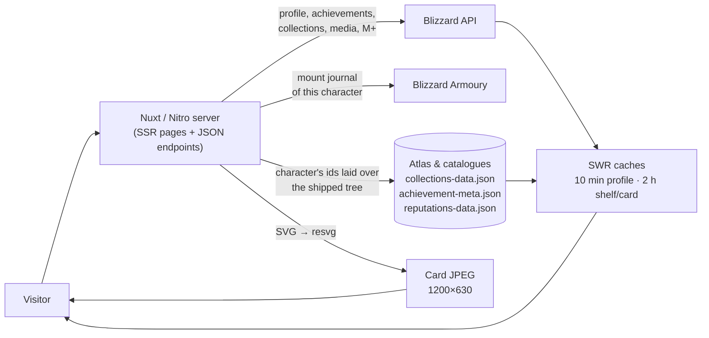

# 🧩 How it works

A page is rendered on the server, so the first response already carries the data — no spinner before
the content. Three kinds of things meet in the process:

- **Live reads.** A character's profile, achievements, collection lists, media and M+ score come from
  Blizzard's profile API, once per character, and the next visitor is answered from a
  stale-while-revalidate cache (ten minutes for a profile, two hours for a shelf or a card) — a burst
  of traffic pays for one lookup.
- **Shipped catalogues.** Everything the game *contains* is paid for offline and compiled into the
  build: the collections atlas, the achievement catalogue, the faction ladders and the total
  fallbacks. None of it is read per request.
- **The card.** `/api/card/…` composes the very icons the page draws into an SVG and rasterises it
  with resvg into a JPEG. That file is what a link preview shows.

### How numbers are written

Every figure on the site — and every figure drawn into the card — is written one way: thousands
grouped by a space, never by a comma and never run together. `1 200` mounts, `44 720` achievement
points, `2 997` M+.

That is not a per-page decision, and it is not `toLocaleString`. The rule lives in exactly one place,
[`shared/utils/formatNumber.ts`](../../shared/utils/formatNumber.ts), and both ends of the project call it:
the Vue pages and the `resvg` card renderer. It is not the language's own separator on purpose — a
comma in English, a non-breaking space in Russian — because the card is drawn by resvg in a font the
site ships, where a glyph a face does not carry is a box, and because a count has to read the same in
the picture as on the page it previews. A figure that must stay on one line is kept whole with
`whitespace-nowrap` where it stands: a layout decision, not a formatting one.

**A figure printed without it is the bug.** Add the `formatNumber` call rather than a local helper —
a second implementation is a second answer.

### How a block arrives

The few hundred milliseconds in which a block comes into being are the same everywhere on the site, and
they are declared once — in [`app/composables/blockEntrance.ts`](../../app/composables/blockEntrance.ts), as VueUse
Motion variants. The stylesheet holds no keyframes for them any more; it holds the glass, the colours and the
layout.

`enterAt(index)` is the one entrance: a fade, a twenty-four pixel rise and a scale from `0.985`, over `560ms`
on `cubic-bezier(0.33, 1, 0.68, 1)` — acceleration at the start, a soft landing. Every variant names
`type: 'tween'` explicitly (rather than leaving Popmotion's spring default in place), so the curve above is the
one a reader actually sees. A list passes the child's index; a standalone block passes the step it takes in the
page's order. `staggerDelay` spends `70ms` per step on the first thirteen children and shares the last step after
that, so a board arrives as one wave and a hundred-card feed still finishes inside a second.

The search sheet is the only block whose **departure** is a VueUse Motion variant; it is played through Vue's
`<Transition>` with `:css="false"`, whose leave hook hands Vue the library's own leave helper
(`transitionLeave`). Its `margin-top` departure takes `260ms`. VueUse Motion itself is not limited to this one
case: it plays every entrance on the site through `v-reveal` (`enterAt` / `enterGlass`), so the library stays
for the arrivals and this is its single departure.

A fold-out is a different motion: height. The comparison board's accordion and the smaller fold-outs — the
phone's navigation groups, the collections, achievements and reputation legends, and the profile note — use
`AppCollapse`, which animates the real height of an open block with the Web Animations API, so a list grows and
shrinks instead of snapping. The stat tray and the leaderboard's extra rows keep their content in the document
while shut, so they use the `v-collapse` directive on a one-track grid (`0fr` → `1fr`, `.hoa-collapse`). Both
take `320ms` on the same curve from `blockEntrance.ts`; a reader who asked for less motion is given the two
states and no travel.

The entrance is one system with one glass exception. Plain content — rows, identity lines, the page's lead —
fades, rises and scales. A surface that carries its own `backdrop-filter` moves by its relative `top` (the search
sheet by `margin-top`): a relative offset does not create a Backdrop Root, so the frost keeps sampling the page
for every frame of the animation, while an `opacity`, `scale` or `transform` would take the liquid glass away
until the animation ended. The split is by surface, not by page, and both shapes live in the same file.

The directive `v-reveal` (`app/plugins/reveal.ts`) is what plays it. It chooses the glass shape when the element
carries a glass class, hands the element to VueUse Motion, and then clears the inline offset / transform / opacity
once the entrance ends — so the frost is there during the whole animation *and* the block settles back into the
state its classes describe. `v-collapse`, the fold-out directive, is registered by the same plugin and reads its
timing from the same file. The templates therefore say only where a block stands in the run; the motion itself
is entirely in `app/composables/blockEntrance.ts`.

Every element that wears a variant also wears `data-motion`. That attribute is what makes the entrance safe for
a reader who has asked not to be moved, and for one whose browser runs no scripts: the stylesheet forces those
blocks to their final state under `prefers-reduced-motion`, and a `<noscript>` entry printed from
`app.head.noscript` in `nuxt.config.ts` does the same when no script runs at all — VueUse Motion writes its
initial `opacity: 0` into the server's markup. A scriptless reader is therefore never left with the hidden half
of the entrance.

Two libraries and two platform APIs carry the motion now, each in one role: `@vueuse/motion`,
`@formkit/auto-animate`, the Web Animations API (`Element.animate`) and `ResizeObserver`. (There are no
`hoa-enter*` / `hoa-leave*` classes left in the stylesheet: a block joins by wearing `v-reveal` with its place
in the run, and `data-motion`.) `@vueuse/motion/nuxt` is registered in `nuxt.config.ts` so the directive and its
presets exist on both ends; AutoAnimate's Vue directive is imported where it is worn.

[`@formkit/auto-animate`](https://auto-animate.formkit.com/) is for the containers whose children are *re-cut
under a reader*: the runs of source and subcategory blocks inside the collections, achievements and reputations
shelves - all of them `
`s, where a child that leaves can be taken out of the flow for its fade without
breaking anything around it. One directive on the parent (`v-auto-animate`), nothing on the tiles themselves, and
the timing is `LIST_MOTION` from the same `blockEntrance.ts` — `320ms` on the site's curve. It is deliberately
kept off tables (see below) and off the realm menu: a list re-cut on every keystroke is not watched settling.
AutoAnimate honours `prefers-reduced-motion` itself.

[`@floating-ui/vue`](https://floating-ui.com/docs/vue) is the one library that only *places* something: where a pane
hangs off the control that opened it, and what it does when the edge of the window is nearer than the pane is wide.
The site draws every pane itself (`.hoa-pop`, `.hoa-tip`), so what is taken from the engine is arithmetic and
nothing else — the question mark that opens a pane (`AppLegend`) reads it through `useFloating`, and the `v-tip`
directive through `computePosition`, both with the site's own gap, margin and middleware in
`app/utils/floating.ts`. It is why a tip near the foot of a page turns and slides instead of leaving the window,
which the fixed, clamped `left` the score's pane used to compute by hand could not do.

A table is the one list the site does not animate child by child, in either direction. AutoAnimate moves a row
safely, but its *removal* puts the leaving `<tr>` back into the document as `position: absolute` - and an
absolutely positioned table row is no longer a table row, so its cells leave the columns until the fade is over,
which is exactly the broken markup a filter or a page step used to leave behind. So the rows of both tables (the
rankings table and the comparison's history table) are simply drawn, and a new answer is announced by one fade of
the body's text (`enterTableText`): every change - another page, another side, another name, another figure, a
period, a refresh - looks the same and the columns never move. The glass has motion of its own: `MetricLeaderboard`
keeps the last answered rows on screen while the next answer is on its way (`shownRows`), and
`MetricLeaderboardTable` watches its own height with a `ResizeObserver` and animates it on `LIST_MOTION` with the
Web Animations API, so a ranking with six players replacing one with nine travels into its new height instead of
collapsing in a frame. The pane clips with `overflow: clip` for the length of the travel — never a scroll
container, so no scrollbar appears — and the table's own horizontal scroller is `overflow-y-hidden`, so shrinking
the pane cannot conjure a second bar.
`height` is layout rather than a compositing property, so the frost never leaves the pane; a table that is still
waiting dims its rows, never the glass, because an `opacity` on the panel would take the frost away for the wait.

The three metric routes share `app/layouts/leaderboard.vue`, which keeps the backdrop mounted while a metric page
changes; their page key is the route's name rather than its full address, so stepping between tables keeps the
same page and the same pane, with the metric, region and realm read through `computed`. `app.vue` draws every
page inside `<NuxtLayout>`, so that frame is used where a page names one and every other page is drawn exactly
as before. The empty state is a `<section>` and the table is the keyed `MetricLeaderboardTable` component, so Vue
cannot reuse the `p-8` empty panel as the table's glass — that reuse is what once left padding and a visible
wrapper around the table.

[`@vueuse/motion`](https://motion.vueuse.org/) carries every arrival a block has: `enterAt` is the one
entrance, `enterGlass` is its shape for a `backdrop-filter` surface, and `enterSheet` is the search sheet's
departure through Vue's `<Transition>`. There is no per-page timing and no second variant: a page chooses only
*where* a block stands in the run (its index, or the delay of a standalone block), never *how* it moves.
Fold-outs are the one motion it does not own: `AppCollapse` and `v-collapse` animate height, because that is
what a panel opening under a row actually changes.

Where it is worn today: every block of every page — the comparison board's row lists and its open rows
(`AppCollapse`), the site's tables (`MetricLeaderboardTable`, `MetricHistoryPanel`), the front door's banner, its five plates and its
breakdown, the collections, achievements and reputation summaries and the shelves under them
(`CollectionSummaryGrid`, `AchievementSummaryGrid`, `CollectionsGrid`, `AchievementShelfGrid`,
`ReputationShelf`), the activity feed, the stat tiles and summary of a character page, the character header
identity, the comparison identity lines, the score legend's pane, the missing-page plate, the search sheet, and
the three document pages (`SiteDocument`: the glass article, its date, intro, sections and references, followed
by the about page's own feature cards, principles and closing actions).
A page added later joins by wearing `v-reveal="index"` and `data-motion`.

A reader whose system asks for less motion is given none of it: `[data-motion]` puts every VueUse Motion block in
its final state, AutoAnimate honours the preference itself, the table's text fade skips itself (`enterTableText`),
the loops Tailwind draws (`animate-spin`,
`animate-pulse`) stand still, and the stylesheet's `scroll-behavior: smooth` returns to `auto` (a scroll a script
asks for still names its own behaviour).

### Endpoints

| Endpoint | Answers |
| --- | --- |
| `/api/character/<region>/<realm>/<name>` | The entire profile the overview draws (`?force=true` re-reads Blizzard) |
| `/api/collections/<region>/<realm>/<name>?kind=mounts` | One shelf, laid over the character's ids — `kind` is `mounts`, `pets`, `toys`, `decors` or `titles`, and `?unobtainable=1` / `?upcoming=1` are the two switches; `?byAccount=1` asks for the account's reading (a guest gets pets, toys and decor, while mounts and titles stay the character's); without `kind` it answers the summary |
| `/api/achievements/<region>/<realm>/<name>` | The achievements summary, laid over the character's log (omit `?category=` for the summary, add it for one category's shelf) |
| `/api/reputations/<region>/<realm>/<name>` | The character's own reputation journal, laid over the shipped faction tree — this character only, never the account's union (see below) |
| `/api/user/heartbeat` (POST) | The presence beat of a reader: one every half minute from an open, visible tab, carrying the browser's own id — it stamps the account when one is signed in (which is what puts that account's main on the hall of fame's online dots) and counts the browser either way, from its second beat; a beat that names a crawler writes nothing |
| `/api/saved` | The characters a signed-in reader looked up and saved with a star, newest first — answered for a visitor too, with two empty lists rather than a 401 |
| `/api/saved` (POST), `/api/saved/star`, `/api/saved/forget` | The three writes behind those lists: a lookup that succeeded, the star either way, and the cross that drops a character from both halves |
| `/api/saved/import` (POST) | The one hand-over: the lists a browser had been keeping for itself, given to the account that has just signed in on it |
| `/api/leaderboard/presence` | Who is on the site right now: how many readers have beaten inside five minutes and how many of them are signed in, and the keys of the mains whose account has beaten, for the table's dots |
| `/api/activity/<region>/<realm>/<name>` | The recent-achievement feed |
| `/api/card/<region>/<realm>/<name>?locale=ru_RU` | The shareable JPEG, 1200×630 |
| `/api/realms` | The realm list the search box completes from |
| `/sitemap.xml` | The pages of the site itself (the front door, the fourteen ranking roots, about, privacy, legal) and every character the site has rendered, with its language alternates |
| `/api/leaderboard?sort=mounts&faction=horde&region=eu&realm=…&class=…&q=…&page=1` | One page of the hall of fame's own table — every member the site holds, ordered by one of nine presets — with the community's totals beside it, cached for an hour. The site's own rows are the rankings under `/api/leaderboard/metrics`; this is the read they are built from, and the API a caller can take a page of everything from |
| `/api/leaderboard/stats` | The population as the front door's plates read it: how many members the site holds, who leads each figure, the class shares, the facets and the day the data was last written - one object, memoised per revision of the data and cached for an hour |
| `/api/leaderboard/character-ranks?region=eu&realm=…&name=…` | Where one character stands in *every* ranking the site keeps, keyed by the ranking's slug and answered as a place or nothing at all - which is what every stat tile and every figure of the drawer on a character's page is linked with, as the `?rank=` of the address each of them opens (`null` for a figure the table holds no reading for, which leaves the door pointing at the ranking itself) |
| `/api/settings` | The site's own editable settings, and public on purpose: the maxima the comparison board measures a figure against, and the page copy an administrator has stored |
| `/api/admin/settings` (POST) | The one write behind the panel - the same two halves, and the only endpoint of the site that refuses a reader by *name*: a visitor without a session is refused with a 401, a signed-in stranger with a 403 |
| `/api/admin/season` (GET/POST) | The Season panel: the stored Mythic+ boundary, the readings on either side of it, the leaderboard, and the process's limits and paths. The POST moves the boundary (or rebuilds the leaderboard) behind the same administrator gate and the same one-operation-at-a-time slot as the other maintenance actions |
| `/api/admin/guests` (GET/POST) | The guest merge: the counts, the groups the fingerprints agree on with their evidence, the merges on file, the switches in force and the timer's own state. The POST is one of four actions — `merge`, `unmerge`, `settings` (which writes the switches and arms the timer in the running process), and `auto` (one pass, now) — behind the administrator gate, a same-origin check and a strict body |

